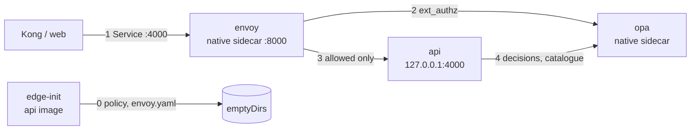

# Aggregator RBAC: Envoy + OPA edge sidecars

Runs the aggregator's RBAC edge next to every `aggregator-api` pod, always: an
Envoy sidecar that every request reaches first, and an OPA sidecar that decides
whether the caller's token roles grant the route's permission.
`aggregator-api.rbac.mode` picks `log` (default) or `enforce` per environment.

| Item | Value |
|---|---|
| App side | aggregator-dpg #910; design `docs/rbac/rbac-edge-enforcement.md` |
| Switch | `aggregator-api.rbac.mode`: `log` (default) / `enforce` |
| OPA image | `ghcr.io/blue-dots-economy/opa-envoy:1.21.1`, built here (`dockerfiles/opa-envoy`): DHI OPA base + upstream Envoy-plugin binary |
| Envoy image | Docker Hardened Image `dhi.io/envoy:1.37`, mirrored to `ghcr.io/blue-dots-economy/dhi/envoy` |
| Needs | An api image that ships `/app/policy/rbac/{rbac.rego,edge.rego,edge/routes.json}` and `/app/policy/envoy/envoy.yaml` |

## Pod layout

| Step | What happens |
|---|---|
| 0 | `edge-init` (the api image) copies the policy and route table into a shared volume and fills in the Envoy template |
| 1 | The Service targets Envoy's port; the api itself listens on `127.0.0.1` only |
| 2 | Envoy verifies the token and asks OPA (`127.0.0.1:9191`, `data.rbac.edge.decision`) |
| 3 | Only an allowed request reaches the api |
| 4 | The api asks OPA its per-organisation questions and publishes the role catalogue (`127.0.0.1:8181`) |

## Decisions

| Decision | Why |
|---|---|
| Policy and Envoy template come from the api image, not this repo | The sidecars always run what the api build was tested with |
| The api binds `127.0.0.1`; the Service targets Envoy | Nothing reaches the api around the edge |
| Own OPA image: DHI OPA base with the upstream Envoy-plugin binary | DHI has no Envoy-plugin OPA; the base keeps the hardened layers, user and entrypoint |
| DHI Envoy through the mirror | Same path and refresh as the other third-party images |
| OPA `--authorization=basic` with a chart-owned `system.authz` policy | Only the api's two queries, its catalogue push and `/health` are allowed, even from inside the pod |
| Envoy admin and OPA REST/gRPC on `127.0.0.1` | Nothing outside the pod can query them or change their state |
| api probes are `exec node fetch` on loopback | `httpGet` cannot reach `127.0.0.1`; probing through Envoy would restart the api when OPA is down |
| Envoy does not wait for Keycloak's DNS at start | Keycloak not resolving must not take down public routes; tokens are refused until it does |
| `--disable-telemetry`, no decision logs | OPA reports its version externally by default; decision input carries the token's personal data |
| Sidecars always on, default `log` | Every environment records edge decisions from the first deploy; nothing is blocked until `enforce` |
| Sidecar resources in `global-resources.yaml` | Same place as every other request and limit |

## Steps

| Step | Where | Status |
|---|---|---|
| A1 Ship the policy, route table and Envoy template in the api image | aggregator-dpg `apps/api/Dockerfile` (#910) | Done |
| B1 `rbac` values (mode, OPA and Envoy images, ports, timeouts) | `charts/api/values.yaml`, `opentofu/aws/template/global-values.yaml` | Done |
| B2 `RBAC_MODE`, `OPA_*`, `HOST=127.0.0.1` | `charts/api/templates/configmap.yaml` | Done |
| B3 `edge-init`, OPA and Envoy sidecars, Service to Envoy, api exec probes | `charts/api/templates/deployment.yaml` | Done |
| B4 `system.authz` policy, OPA edge config, `edge-init.js` | `charts/api/files/`, `templates/rbac-configmap.yaml` | Done |
| B5 Sidecar resources | `helm/global-resources.yaml` | Done |
| B6 Render checks; the pod simulated in Docker (shared network namespace) | local, CI `helm lint` / `template` | Done |
| B7 Docs | `helm/CLAUDE.md`, `helm/aggregator/README.md` | Done |
| B8 Envoy on the DHI mirror; `opa-envoy` image and its workflow; CI image check | `.github/`, `dockerfiles/opa-envoy` | Done |
| B9 `roles` attribute (admin-only, multivalued) and access-token mapper | `helm/keycloak/files/apply-user-profile.sh`, deployment `realm.json` | Done |

## Rollout per environment

1. Once per GitHub org:
   - after the mirror workflow first copies `envoy`, make the `dhi/envoy` package public;
   - run **Build OPA Envoy image** (`build-opa-envoy-image.yml`), then make the `opa-envoy` package public.
2. Deploy Keycloak, so the realm declares `roles` and maps it into the access token.
3. Deploy an api image from aggregator-dpg #910 (A1) with the default `rbac.mode: log`. At start the api writes every user's `roles` attribute (its reconcile), publishes the role catalogue to OPA, and Envoy logs each request (`operation: rbac.edge`, `outcome` allow / would_deny / deny).
4. Run the backfill once, so existing coordinators keep exporting: `psql "$DATABASE_URL" -f scripts/sql/rbac-backfill-roles.sql` (aggregator-dpg; gives active coordinators Data Export and 90-day PII Access, skips any they hold).
5. Check the Envoy logs for `would_deny` that should not be, then set `rbac.mode: enforce` and deploy.

Back out of enforcement by setting `mode: log`.

## Not in this change

| Item | Where it is tracked |
|---|---|
| Portal gate for org owners and admin-only attributes in the deployment realm (H-11) | aggregator-dpg RBAC plan, bluedots-automation row |
| A full rebuild of the deployment realm from aggregator-dpg (`scripts/build-realm.sh`): it also carries the Phase 5 portal-gate changes, and its output fails `scripts/assert-realm.sh` today | Separate change; only the `roles` mapper is added here |
| OPA in the worker | Deferred in the RBAC plan (worker re-check) |
